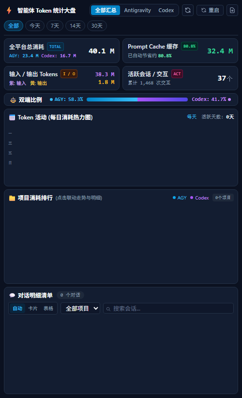

# Antigravity Token Calculator

<p align="center">
  
</p>

<p align="center">
  <b>Google Antigravity 2.0 原生侧边栏 Token 消耗统计与多项目用量分析插件</b>
</p>

<p align="center">
  
  
  
</p>

<p align="center">
  
</p>

---

## 项目简介

在多项目开发与长程会话场景中，各工程与对话的 Token 实际用量分布往往分散在本地日志与缓存深处，缺乏统一透明的跨端统计视图。

Antigravity Token Calculator 依托 Antigravity 原生 UI Sidecar 架构构建，独立运行于辅助窗格中。它在不侵入对话上下文、不消耗对话 Token 的前提下，全本地原生解析双端（Antigravity 与 Codex）元数据与交互日志，提供多维度的用量指标、自适应活动大盘及一键数据导出能力。

---

## 核心功能

- **双端统一聚合**：自动整合 Antigravity 与 Codex 本地全量会话日志与元数据，支持全平台汇总与单端无感切换。
- **53 周自适应活动热力图**：完整呈现 1 月至 12 月全年 53 周活动轨迹，采用弹性自适应网格排布，横纵坐标智能居中贴合，彻底消除横向滚动条；支持点击单日即时下钻筛选当日明细。
- **核心用量指标与双端配比**：实时汇总全平台总消耗、总请求次数、缓存命中收益及有效会话数，配备双端消耗占比条直观呈现平台分布。
- **按项目排行与多维联动**：自动归类工程项目用量排行与占比进度条，支持项目卡片点击下钻与顶部过滤标签快速清除联动。
- **会话明细与客户端秒搜**：支持按时间周期（全部 / 今天 / 7天 / 14天 / 30天）多维过滤，内置毫秒级客户端全文检索，快速定位目标对话。
- **双通道账单导出**：支持一键导出包含 UTF-8 BOM 的完整结构化 CSV 报表，后端直存系统「下载」目录与前端触发下载双重保障。
- **零外部依赖**：后端完全基于 Python 3 标准库（`sqlite3`、`json`、`http.server`），前端采用原生 HTML5 与 Tailwind，无需执行任何 `pip install` 即可开箱即用。

---

## 数据与文件说明

本插件完全在本地运行，不发起任何外部网络请求。相关读写路径如下：

### 1. 读取文件（只读访问）
- **Antigravity 数据**：读取 `~/.gemini/antigravity/conversations.db`（提取会话元数据）及各会话目录下的 `transcript.jsonl`（提取 Token 消耗步进）。
- **Codex 数据**：读取 `~/.codex/` 相关目录下的会话元数据与用量记录。
- *注：所有读取操作均为只读模式，不修改任何原生历史数据。*

### 2. 生成文件
- **扫描缓存**：`~/.gemini/token_tracker_cache.json`（用于本地增量计算加速，可在面板中点击「重启」清除重扫）。
- **导出文件**：`~/Downloads/token_usage_export_YYYY-MM-DD.csv`（仅在用户点击「导出 CSV」按钮时写入系统下载目录）。

---

## 安装指引 (Windows)

### 环境要求
- Windows 10 / 11
- Python 3.8+（支持 Windows 官方 `py` 启动器）
- Google Antigravity 2.0+

### 方式 1：直接让 Agent 自动安装（推荐 · 免切终端）
直接复制以下一句话发送给当前对话中的 Agent 即可全自动安装完成：

> 帮我安装 Token 统计插件：https://github.com/Summer-kk/antigravity-token-calculator.git

### 方式 2：手动终端安装（PowerShell）
打开 Windows PowerShell，执行以下一行命令克隆至插件目录：

```powershell
git clone https://github.com/Summer-kk/antigravity-token-calculator.git "$HOME\.gemini\config\plugins\token-calculator"
```

克隆完成后无需重启主程序，插件将自动加载。

---

## 使用方式

1. **界面直接打开**：
   打开侧边栏 -> 扩展 -> Token 统计 即可直接唤起仪表盘面板。

2. **协议链接直达**：
   在任意对话或文档中点击下方专属协议链接，主程序将直接在侧边栏唤起面板：
   `sidecar://token-calculator/token-dashboard/`

3. **通过 Agent 自然语言交互**：
   在对话中向 Agent 发送如下指令，Agent 将自动提供侧边栏入口：
   - “打开 Token 统计侧边栏仪表盘”
   - “查看最近各项目 Token 消耗”
   - “导出全量 Token 消耗明细为 CSV”

---

## 数据接口说明

Sidecar 后端内置轻量 HTTP API 服务：

| 接口路由 | 请求方式 | 功能描述 |
| :--- | :--- | :--- |
| `/` 或 `/index.html` | `GET` | 侧边栏仪表盘响应式 HTML 页面 |
| `/api/tokens` | `GET` | 实时解析本地元数据并返回双端聚合 JSON 数据 |
| `/api/export` | `GET` | 下载包含 UTF-8 BOM 的对话消耗明细 CSV |
| `/api/export_save` | `GET` | 直存 CSV 至系统「下载」文件夹并返回绝对路径 |
| `/api/restart` | `GET` | 清除本地扫描缓存并触发强制全量重扫 |

---

## 架构与文件结构

```text
antigravity-token-calculator/
├── .gitignore               # Git 忽略规则清单
├── LICENSE                  # MIT 开源许可证
├── README.md                # 项目文档
├── plugin.json              # 插件核心清单与元数据
├── assets/
│   ├── logo.svg             # 插件矢量图标 (128x128)
│   ├── preview.png          # 视网膜高清脱敏预览图
│   └── preview.html         # 离线交互演示页面
├── rules/
│   └── AGENTS.md            # Agent 行为规范与侧窗入口指引
└── sidecars/
    └── token-dashboard/
        ├── sidecar.json     # Sidecar 启动规格与命令配置 (command: "py")
        ├── server.py        # 本地 HTTP 路由服务 (含进程重启与双通道导出)
        ├── collector.py     # 双端 Token 统计与元数据解析聚合引擎
        └── index.html       # 原生前端可视化仪表盘
```

---

## 开源协议

本项目遵循 [MIT License](LICENSE) 开源协议。
